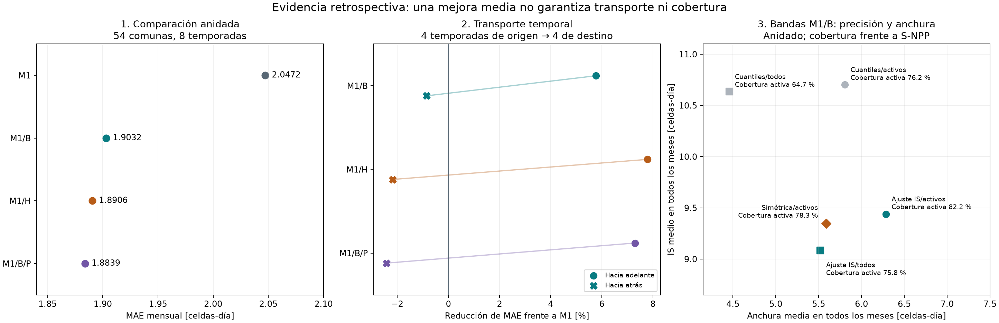

# Decisión científica de GOLIAT: evidencia acumulada y siguiente prueba

**Mantener M1 y las 14 compuertas publicadas.** Los modelos ensayados reducen el error medio retrospectivo, pero sus ventajas dependen del período, la población y el estado observado. La mejora más útil de incertidumbre es hacer depender la anchura de la actividad estimada; sus extensiones aún necesitan una prueba futura definida de antemano. Mantener la publicación no certifica su equivalencia física ni su cobertura.

La figura se genera con `pipeline/render_research_overview.py` desde los resultados guardados. Las tres comparaciones responden preguntas diferentes: menor MAE anidado, estabilidad al trasladar el modelo y compromiso entre pérdida/anchura/cobertura. No se combinan en un score que oculte un fallo relevante.

## Qué se está estimando

El objetivo es actividad satelital diurna, agregada en celdas-día de 0,01° por plataforma y mes, para 54 comunas de Biobío y Ñuble. La referencia es S-NPP; no es un catálogo exhaustivo de incendios. Los parámetros se ajustan a Aqua y no autorizan sumar Terra u otras plataformas como eventos independientes.

La publicación observada usa S-NPP en temporadas 2012–2017 y NOAA-20 desde 2018, mientras que estos errores de calibración se calculan frente a S-NPP. Por tanto, una mejora frente al objetivo S-NPP no demuestra por sí misma una mejora frente a la serie publicada de NOAA-20. El puente regional declarado con factor 1,0 no establece equivalencia comunal; conservar M1 tampoco certifica ese puente.

Entrenamiento: temporadas 2012–2019, julio–junio según el año inicial. La evaluación anidada excluye cada temporada externa del ajuste de máscaras, normalizaciones y selección. Las ocho temporadas constituyen un conjunto de desarrollo reutilizado para proponer familias sucesivas. El anidamiento limita fuga dentro de cada experimento; **no elimina la adaptación entre experimentos**.

El M1 publicado tiene factor completo 2,352954072125397. En las tablas anidadas M1 se vuelve a ajustar en cada origen: su MAE no debe describirse como resultado de aplicar ese único factor completo sobre el mismo entrenamiento.

2020–2021 comprende julio 2020–junio 2022; se excluyen agosto/septiembre 2020 en ambas plataformas. Enero–junio 2022 se identifica además por año calendario por la transición orbital. Los destinos 2020–2025 se consultaron durante el desarrollo y son descriptivos, no un holdout nuevo.

## Estimación central: conservar la mejora y su contraejemplo

| Política experimental | MAE mensual anidado | Mejora frente al M1 anidado | Límite decisivo |
| --- | ---: | ---: | --- |
| M1 | 2,04724 | referencia | No reconstruye señal cuando Aqua=0; es un comparador, no verdad física |
| M1/B, afín regularizado | 1,90319 | 7,04 % | Transporte hacia atrás con cuatro temporadas empeora frente a M1 |
| M1/H, afín Huber | 1,89061 | 7,65 % | No domina B en todos los estados; persiste fragilidad temporal |
| M1/B/P, selección afín o por tramos | 1,88393 | 7,98 % | Ganancia incremental pequeña y transporte hacia atrás desfavorable |
| M1/B/C, Aqua+Terra | 1,92613 | 5,92 % | Añadir C empeora 1,21 % frente a B; 7/8 temporadas desfavorables |

Son errores frente al producto satelital de referencia, en celdas-día mensuales, no precisión sobre eventos o superficie quemada. Los intervalos por bootstrap de ocho temporadas son exploratorios. No usar comunas o meses como miles de réplicas independientes.

La prueba de transporte 2016–2019→2012–2015 deja a B un 0,85 % peor que M1 y a B/P un 2,42 % peor. Con seis temporadas de origen B mejora en la dirección inversa, y con todos los subconjuntos de cuatro la variabilidad es amplia. Esto impide concluir que todo transporte falla, pero también elegir solo el tamaño o subconjunto favorable después de ver el destino. Véanse [etapa 8](2026-11-14-scientific-review-8.md) y [etapa 10](2026-11-14-scientific-review-10.md).

Los interceptos recuperan parte de los meses Aqua=0/S-NPP>0 y añaden estimaciones donde ambos registran cero. Es un intercambio de error frente a la referencia; no identifica automáticamente incendios omitidos ni falsos incendios. Terra aporta señal en 196 de los 1.152 meses Aqua=0/S-NPP>0, pero esta clase monotónica no obtiene una mejora global estable sobre B. La conclusión afecta a la clase ensayada, no a toda utilización de Terra. [Etapa 14](2026-11-14-scientific-review-14.md).

## Incertidumbre: mejora de pérdida con cobertura todavía irregular

La banda publicada basada en MAE se describe como una banda de error empírico; no es un intervalo probabilístico certificado. La [etapa 11](2026-11-14-scientific-review-11.md) reproduce parámetros congelados y mide sus límites en destinos posteriores ya consultados.

La [etapa 12](2026-11-14-scientific-review-12.md) compara escalas fijas: constante, raíz y relativa. Para M1/B, la raíz reduce IS activo 19,35527→16,45255 frente a la escala constante, con cobertura activa casi igual (78,23→78,31 %) y mayor anchura. La relativa alcanza más cobertura en extremos a costa de intervalos mucho más anchos y peor pérdida. No confundir cobertura con precisión.

La [etapa 13](2026-11-14-scientific-review-13.md) conserva las ocho combinaciones de punto, cohorte y simetría. Cambiar a cuantiles asimétricos no domina la raíz simétrica/activa.

La [etapa 15](2026-11-14-scientific-review-15.md) ajusta directamente la pérdida IS original, con clipping y extremos ordenados. Mejora al control asimétrico empírico en las ocho temporadas para cada punto y cohorte, pero mantiene este intercambio:

| M1/B, escala raíz | IS todos los meses | Cobertura activa | Anchura activa |
| --- | ---: | ---: | ---: |
| Referencia simétrica, calibración activa | 9,34861 | 78,31 % | 8,94065 |
| Ajuste IS, calibración activa | 9,43924 | 82,17 % | 10,15804 |
| Ajuste IS, calibración todos los meses | 9,08305 | 75,81 % | 9,28979 |

La receta con mejor IS global no tiene la mayor cobertura activa. Con ajuste IS/activo, los meses S-NPP≥50 alcanzan solo 64,86 % de cobertura en las 54 comunas y 62,50 % en las 14 publicadas. Esos números impiden anunciar una cobertura general del 80 %. Las 14 comunas fueron seleccionadas con evidencia del mismo desarrollo, de modo que su evaluación también está condicionada por selección.

## Datos, geografía y fuentes externas

- **Cartografía y grilla:** cambios pequeños de asignación alteran las compuertas diagnósticas (12–17 según escenario). Comparar candidatos con el mismo objetivo dentro de cada escenario; no declarar más precisión por tener un MAE absoluto menor frente a un objetivo distinto. [Etapa 6](2026-11-14-scientific-review-6.md).
- **Continuidad VIIRS:** razones regionales próximas a uno entre plataformas no demuestran equivalencia local. El WAPE mensual comunal ronda 29–30 % en los puentes ensayados; conservar identificador de plataforma y períodos. [Etapa 7](2026-11-14-scientific-review-7.md).
- **CONAF:** el panel principal da Spearman regional 0,0979, con un intervalo exploratorio muy amplio. Las ocurrencias administrativas y las celdas-día satelitales miden objetos distintos. No validan conteos de incendios ni la transformación Aqua→S-NPP. Los tres blancos del XLSX siguen siendo desconocidos, no cero. [Etapa 9](2026-11-14-scientific-review-9.md).
- **Observabilidad:** haber solicitado datos de un día no prueba cielo despejado, cobertura suficiente ni oportunidad equivalente. Cero detecciones permanece distinto de ausencia física. Falta incorporar información de observación para resolver esta limitación.
- **Generalización:** este piloto regional no demuestra comparabilidad global, equivalencia física retrospectiva antes de VIIRS ni causalidad sobre prevención. La grilla angular tampoco es automáticamente de igual superficie en todo el planeta.

## Criterio de avance

Separar tres decisiones: conservar una alternativa experimental, cambiar la publicación y afirmar validez científica externa. Un buen score en desarrollo permite la primera; no autoriza por sí solo las otras dos.

La siguiente evaluación debe fijar antes de leer etiquetas: producto y plataforma de referencia, regiones/períodos completos, oportunidades observables, tratamiento de ausencias y NRT, versión de cartografía, comparadores y estratos. Congelar código y parámetros con hashes. Definir una métrica primaria y presentar igualmente extremos, Aqua cero, ambas plataformas cero, 54 comunas y población publicada. Una prueba con NOAA-20/21 exige evaluar el puente local; no reemplazar S-NPP silenciosamente.

Debe conservarse un destino sin consultar para la decisión final. Si ya se usó para diseñar, elegir o explicar modelos, se declara parte del desarrollo. Un período parcial de la temporada actual y datos NRT no se convierten retrospectivamente en una temporada consolidada ni en evidencia independiente.

No se amplían compuertas, no se publica un nuevo modelo y no se cambia el significado de los números para exhibir más cobertura territorial. La revisión científica y de producto deben acordar cualquier cambio publicado conforme a los alcances del repositorio.

## Trazabilidad y reproducción

Cada etapa conserva protocolo, código, controles, resultados completos y manifiesto. La reproducción aislada toma las tablas procesadas versionadas; no reconstruye toda la ingestión FIRMS original. La guía explica cómo repetirla con un entorno nuevo desde `uv.lock`: [procedimiento](2026-11-14-reproduction-guide.md).

La primera repetición, checkout `2f3a8db`, reprodujo **118 archivos de resultados byte por byte** en los 14 bloques. Sus 14 manifiestos difieren exclusivamente en `source_head`, snapshots de JSON derivados incorporados desde producto y hashes de manifiestos previos. Pasaron los 85 tests presentes en ese commit. Los archivos públicos y científicos originales permanecieron intactos.

La auditoría histórica contrastó 2.124 hashes: 2.016 coinciden con archivos actuales y 108 con versiones históricas en Git. Los 108 son los 54 JSON derivados en dos snapshots previos a la actualización de producto; ninguna discrepancia quedó sin explicación. No se reescribieron manifiestos anteriores para hacerlos coincidir.

La segunda repetición, checkout `076fc9b`, reconstruyó un entorno con las 19 versiones de `uv.lock`, reprodujo también los 118 archivos de resultados byte por byte y pasó sus **88 tests**. Las diferencias de sus 14 manifiestos son exclusivamente las mismas categorías documentadas. Ambas reproducciones usan la misma máquina y los mismos datos: son evidencia de reproducibilidad técnica, no una réplica científica externa.

La reconstrucción adicional desde detecciones reprodujo los cuatro Parquet agregados como multiconjuntos y los tres CSV de evaluación/compuertas y `params.json` byte por byte. Sin embargo, la comparación estricta de los 54 JSON comunales **falló por el orden no determinado de `recurrence`**. Todos los registros y demás campos coinciden. Se conserva el fallo y su diagnóstico; no se declara que la publicación haya pasado una igualdad que no cumple. El índice difiere además en el timestamp esperado.

Los 1.071 CSV FIRMS inventariados (101.477.474 bytes) no están disponibles localmente. Se deja esa carencia como límite explícito: no se ha reproducido la ingestión desde crudos. No afecta a la igualdad comprobada desde los insumos procesados, pero impide extender esa afirmación a toda la cadena.

[Evidencia de las dos reproducciones](evidence/2026-11-14/fresh-environment-reproduction.json), [diferencias de manifiestos](evidence/2026-11-14/fresh-environment-manifest-differences.json), [auditoría histórica](evidence/2026-11-14/historical-integrity.json), [reconstrucción de base](evidence/2026-11-14/baseline-reconstruction.json) y [disponibilidad de crudos](evidence/2026-11-14/raw-availability.json). CI remoto valida web; los 88 tests científicos aquí documentados se ejecutaron localmente en el entorno reconstruido.

La corrección aislada del orden está disponible para revisión en el [PR #31](https://github.com/Loddrik/goliat-fire-calendar/pull/31), con base `dev`. El nuevo test falla con el publicador anterior y pasa al ordenar; los cuatro tests de publicación pasan. No se regeneraron los archivos públicos.

## Controles adicionales y automatización

Se añadieron dos regresiones sobre todos los destinos reales guardados, sin reajustar parámetros ni calcular nuevos scores de desempeño. Se restauran las 3.780 estimaciones y los 37.800 intervalos; permutar, reemplazar por cero, volver desconocidas o eliminar las etiquetas de referencia no cambia puntos ni extremos. Barajar las filas tampoco cambia los resultados emparejados por clave. Las firmas y calibraciones permanecen intactas. El conjunto actual de **90 tests pasa** en el entorno reconstruido. Las reproducciones completas anteriores ejecutaron los 85/88 tests presentes en sus respectivos commits.

El workflow científico nuevo instala Python 3.14.7, uv 0.11.7 y dependencias fijadas para ejecutar las regresiones en Linux. Tras corregir un error inicial de configuración, la [ejecución del commit 29d9d99](https://github.com/Loddrik/goliat-fire-calendar/actions/runs/43653044330) completó el job científico y su paso de tests. Esto añade evidencia de ejecución entre sistemas para las regresiones; no significa que todos los experimentos completos se hayan recalculado en Linux.

## Distribución del beneficio y control de orden

El [desglose comunal](2026-11-14-aggregation-review.md) confirma que la mejora media no es uniforme: B mejora 22 comunas, empeora 17 y empata 15; su mediana de beneficio absoluto es cero. Las cinco mayores mejoras reúnen 49,14 % de la ganancia bruta positiva. La mejora B en las 14 publicadas es 3,45 % en este anidamiento, frente a 7,04 % global; no confundirla con el 0,69 % de su bloque posterior descriptivo.

El [control de orden físico](2026-11-14-row-order-review.md) conserva los multiconjuntos y el esquema Arrow completo en una copia temporal. Reproduce exactamente 117 de los 118 archivos; el resumen geográfico cambia sus listas de diez ejemplos, seleccionadas con `head(10)` según el orden de entrada. Las métricas, parámetros y restantes valores del resumen coinciden, y pasan 90 tests. Se registra que la igualdad estricta de 118 archivos **no pasó**, sin relajar el criterio para declararla aprobada.

La [CI de 27a3cc6](https://github.com/Loddrik/goliat-fire-calendar/actions/runs/43653588142) ejecutó y pasó los 90 tests científicos en Linux; el log se conserva con la evidencia.
