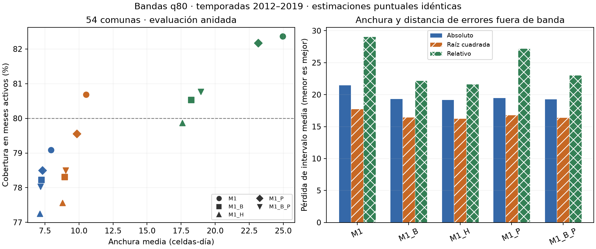

# Revisión científica 12 — una banda que crece con la actividad mejora la pérdida, con costes visibles

**Conclusión:** la regla de raíz cuadrada es una candidata de incertidumbre prometedora sin cambiar las estimaciones puntuales. Reduce la pérdida de intervalo de M1/B un **15,00 %** en meses activos del desarrollo anidado y mejora esa pérdida en ocho de ocho temporadas. Sin embargo, redistribuye cobertura y aumenta anchura en actividad alta; no es una garantía de cobertura ni una autorización para sustituir los radios publicados.

El [protocolo 12](2026-11-14-science-protocol-12.md) se fijó antes de comparar estas bandas. Las quince combinaciones de cinco políticas puntuales y tres reglas de radio permanecen en los artefactos, incluidas las desfavorables. Las temporadas y destinos ya habían sido consultados: separación computacional correcta no convierte este desarrollo adaptativo en validación independiente.

## Qué se comparó

Para estimación p≥0 se usa s(p)=(1+p)^a, con a=0 (absoluto), a=0,5 (raíz) o a=1 (relativo). Se aprende el percentil 80 de |y−p|/s(p) en meses activos del conjunto permitido de calibración. El radio futuro es ese cuantil multiplicado por s(p); no necesita la etiqueta futura ni saber si el mes será activo. El desplazamiento 1 evita escala cero, sin suponer que las celdas-día sigan una distribución Poisson.

La pérdida de intervalo IS penaliza anchura y distancia de las observaciones fuera de sus extremos, con α=0,2. **Menor es mejor**. La fórmula procede de la ecuación 43 de [Gneiting y Raftery (2007)](https://sites.stat.washington.edu/raftery/Research/PDF/Gneiting2007jasa.pdf). Nuestras bandas simétricas no son necesariamente cuantiles centrales: usar esa pérdida no certifica una distribución ni cobertura nominal.

## Separación y controles

Se recalcularon **64 ajustes**: ocho folds externos con siete internos cada uno, más el ajuste externo correspondiente. Cada máscara y candidato se aprendió excluyendo la temporada externa. La selección y la calibración comparten datos internos; no es split conformal ni tiene garantía distribucional. No se reciclaron registros OOF globales para calibrar folds, lo que habría permitido fuga indirecta a través de sus ajustes.

Se reprodujeron, dentro de tolerancia 1e-10:

- Conteos y estimaciones puntuales de las cinco políticas frente a los artefactos 4–5.
- Radios absolutos de esas políticas y radios relativos de M1 y M1/B frente a las etapas previas.
- El radio absoluto final de etapa 11 **exactamente**, y la firma del modelo puntual congelado `d199e3f7857de17cc8d3b70d392c6c7e60ea1694bb58163de27bf7135dcc5868`.

Se guardaron los tres radios finales antes de leer los 3.780 pares posteriores. No se modificaron coeficientes, elecciones, máscaras de producción ni bandas anteriores.

## Comparación anidada 2012–2019

54 comunas, **2.563 meses activos S-NPP**. IS y anchura están en celdas-día. Los promedios de esta tabla ponderan cada mes activo por igual; las comparaciones por temporada se calculan aparte para no tratar los meses como réplicas independientes.

| Política | IS absoluto → raíz | Reducción de IS | Cobertura absoluto → raíz | Anchura absoluto → raíz | Temporadas con menor IS |
| --- | ---: | ---: | --- | --- | ---: |
| M1 | 21,51 → 17,76 | 17,43 % | 79,09 % → 80,69 % | 7,94 → 10,52 | 7/8 |
| M1/B | 19,36 → 16,45 | 15,00 % | 78,23 % → 78,31 % | 7,24 → 8,94 | 8/8 |
| M1/H | 19,20 → 16,26 | 15,30 % | 77,25 % → 77,57 % | 7,12 → 8,78 | 8/8 |
| M1/P | 19,50 → 16,81 | 13,81 % | 78,50 % → 79,56 % | 7,32 → 9,84 | 7/8 |
| M1/B/P | 19,30 → 16,43 | 14,88 % | 78,03 % → 78,50 % | 7,17 → 9,02 | 8/8 |

Para M1/B, la diferencia media de IS raíz−absoluto por temporada es **−2,9162**, favorable en las ocho. El cambio entre los promedios mensuales de la tabla es −2,9027: los dos cálculos ponderan de manera distinta cuando las temporadas tienen diferente cantidad de meses activos. No se construyeron intervalos inferenciales ni se interpretaron las múltiples comparaciones como confirmación independiente.

El control relativo obtiene mayor cobertura, pero anchuras grandes y peor pérdida: para M1/B, cobertura **80,53 %**, anchura **18,23** e IS **22,20**, frente a 78,31 %, 8,94 y 16,45 con raíz. La cobertura por sí sola favorecería una opción que aquí resulta menos útil según el criterio de anchura y distancia de fallos.

En todos los 5.184 meses, incluidos ceros, M1/B raíz baja IS de **11,5104 a 9,3486**, mientras la anchura media pasa de 5,4387 a 5,5882. Esa mejora agregada no elimina el coste condicionado por intensidad.



La figura es retrospectiva, conserva las quince combinaciones y no representa cobertura física de observación. También se exportó una versión SVG.

## La cobertura se redistribuye: no ocultar la actividad baja

M1/B, meses activos del desarrollo anidado, desglosados por el conteo S-NPP usado únicamente para evaluar:

| Intensidad S-NPP | n | Cobertura absoluta / raíz / relativa | Anchura absoluta / raíz / relativa | IS absoluto / raíz / relativo |
| --- | ---: | --- | --- | --- |
| 1–9 | 2047 | 86,86 % / 81,29 % / 78,46 % | 6,25 / 5,57 / 6,76 | 8,89 / 8,48 / 10,04 |
| 10–49 | 442 | 46,38 % / 67,19 % / 87,10 % | 10,84 / 19,16 / 44,47 | 44,76 / 37,41 / 51,77 |
| ≥50 | 74 | 29,73 % / 62,16 % / 98,65 % | 13,01 / 41,03 / 179,04 | 157,04 / 111,74 / 181,88 |

Raíz mejora cobertura de los 74 meses con S-NPP≥50 de **29,73 % a 62,16 %**, aumentando su anchura de 13,01 a 41,03 y reduciendo IS de 157,04 a 111,74. Pero en los 2.047 meses con 1–9 celdas-día la cobertura baja de **86,86 % a 81,29 %**. No afirmar que mejora la cobertura de cada mes o nivel de actividad.

El relativo cubre 98,65 % de los meses ≥50, con anchura media **179,04** e IS 181,88. Es otro ejemplo de por qué no se debe optimizar únicamente cuántas observaciones caben dentro de la banda.

Los fallos también se vuelven más asimétricos: en M1/B raíz, **4,96 %** de meses activos queda por debajo del límite y **16,74 %** por encima, frente a 10,03 % y 11,74 % con absoluto. Las bandas simétricas alrededor del punto no necesariamente producen colas centrales equilibradas; estudiar esa limitación requerirá otro protocolo, no ajustar los límites con este destino.

## Diagnóstico posterior reutilizado

Los radios finales se aprenden solo con las estimaciones de política OOF anidadas de 2012–2019 y se aplican al modelo completo restaurado de etapa 11. Son los mismos bloques y transición calendario, sin modificar sus datos. No son un holdout nuevo.

M1/B, 54 comunas, meses activos:

| Bloque | Regla | n | Cobertura | Anchura media | IS medio |
| --- | --- | ---: | ---: | ---: | ---: |
| 2020–2021 | Absoluto | 599 | 78,96 % | 7,27 | 20,12 |
| 2020–2021 | Raíz | 599 | 78,46 % | 8,70 | 17,53 |
| 2020–2021 | Relativo | 599 | 80,30 % | 16,22 | 22,63 |
| 2022–2025 | Absoluto | 1.257 | 74,70 % | 7,48 | 27,11 |
| 2022–2025 | Raíz | 1.257 | 77,01 % | 9,73 | 22,36 |
| 2022–2025 | Relativo | 1.257 | 79,16 % | 22,89 | 28,20 |

Raíz reduce IS también en esos agregados, pero no mantiene 80 % de cobertura. En el subgrupo de 14 publicado, M1/B raíz cubre **80,51 %** de meses activos 2020–2021 y **77,18 %** en 2022–2025. Para M1 con puntos publicados, raíz cubre 76,92 % y 76,29 %, menor que el q80 absoluto correspondiente aunque reduzca IS. No seleccionar la política o el período que deje la cifra más cercana al objetivo nominal.

## Decisión y límites

1. Mantener la publicación actual. La mejora se refiere a la forma de una banda experimental; no corrige la falta de observabilidad, valida continuidad NOAA ni demuestra precisión de la reconstrucción 2002–2011.
2. La raíz merece evaluación adicional porque mejora la pérdida de intervalo sin aumentar complejidad de las estimaciones puntuales. No implica que haya que sustituir M1 por B, H o P.
3. No presentar una banda calibrada en meses activos como incertidumbre incondicional garantizada para un mes cuyo estado se desconoce. La dependencia del resultado respecto del conjunto de calibración y la asimetría de sus colas son las siguientes preguntas concretas.
4. Cualquier eventual cambio de publicación debe declarar si reemplaza el error típico MAE por otro estimador, actualizar su explicación y revisar el contrato con producto. Aquí no se cambió el significado de ningún campo público.

## Artefactos y verificación

`data/processed/scaled_band_audit/` contiene **77.760 intervalos anidados**, **56.700 intervalos posteriores**, radios por fold y finales, registro de temporadas de cada ajuste, métricas de las quince combinaciones, contrastes por temporada, figuras PNG/SVG y manifiesto de hashes. Los datos originales, parámetros, compuertas y publicaciones se conservaron durante la ejecución; todos los controles pasaron. No hubo filas sin radio de calibración en esta ejecución, pero el código conserva ese estado como desconocido cuando ocurre, sin rellenarlo con cero.

```sh
uv run python -m unittest discover -s tests -p 'test_scaled_band.py' -v
uv run python pipeline/scaled_band_audit.py
```

Seis tests nuevos cubren fórmula de IS y ambos tipos de exceso, escala en cero, normalización, falta de calibración, independencia de etiquetas futuras y exclusión de la temporada externa de todos los ajustes. **66 tests Python pasan**. La figura fue inspeccionada y los resultados numéricos se contrastaron con los CSV. Las decisiones de selección para producción siguen pendientes de evidencia y revisión, no se deducen de una sola métrica favorable.

## Sincronización posterior con producto

Después del experimento se incorporó `dev` hasta `f49a9af` en las tres ramas científicas. Incluye cuartiles derivados con interpolación, número de temporadas con detección por mes y respeto de `?lang`. Se verificaron los 648 resúmenes comuna/mes contra la serie observada y sus celdas contra la recurrencia. Los 13 tests JS, build y lint pasan; solo persisten advertencias ya existentes.

Los 54 JSON comunales de `derived/` cambian legítimamente por ese trabajo de producto. Por eso los hashes de protección de esos archivos en el manifiesto del experimento corresponden a su instantánea **anterior** a la integración (`source_head=f8c6e07`), no a los nuevos metadatos. Los Parquet científicos, parámetros, compuertas, JSON principales de las comunas y todos los artefactos de investigación siguen idénticos. No se reescribió el manifiesto histórico ni se recalculó una puntuación con la nueva climatología de producto.
