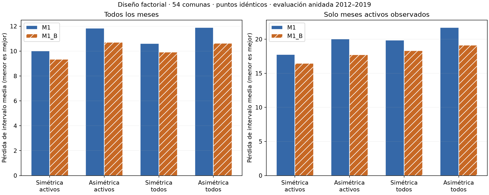

# Revisión científica 13 — cambiar la forma o añadir ceros a calibración no mejora automáticamente la banda

**Conclusión:** las nuevas recetas no superan al control simétrico/activo/raíz en el criterio primario fijado: pérdida de intervalo sobre todos los meses. La asimetría mejora un subgrupo de señal perdida por Aqua, pero empeora otros; calibrar con todos los meses acerca la cobertura global a 80 % a costa de reducir mucho la cobertura activa. No cambiar la receta por un resultado parcial favorable ni publicar nuevas bandas.

Se ejecutó el [protocolo 13](2026-11-14-science-protocol-13.md): dos puntos preexistentes (M1 y M1/B), escala raíz fija y diseño 2×2 de conjunto de calibración (activos/todos) y forma (simétrica/asimétrica). Las ocho combinaciones quedan publicadas, sin adaptar sus parámetros después de evaluar el destino. La comparación sigue siendo desarrollo retrospectivo y adaptativo, no validación independiente.

## Definiciones y controles

La banda simétrica usa q80 del error absoluto normalizado por sqrt(1+p). La asimétrica usa q10 y q90 del residuo firmado `(y−p)/sqrt(1+p)`, con interpolación lineal y ambos extremos recortados a cero. No se fuerza que contenga el punto. Calibración activa significa seleccionar etiquetas **pasadas** S-NPP>0; nunca escoger receta según el estado del mes futuro.

Se repitieron los 64 ajustes de la validación anidada capturando sus predicciones internas. El destino externo quedó fuera de ajuste, selección, máscara y calibración. Se reprodujeron puntos y extremos del control simétrico/activo/raíz de etapa 12, tanto en el desarrollo como en los 3.780 pares posteriores. También sus parámetros finales y la firma del modelo puntual congelado permanecieron iguales. La selección y calibración comparten origen; esto no proporciona garantía conformal.

## Resultado principal

54 comunas, 5.184 meses totales y 2.563 activos S-NPP. IS usa α=0,2 y **menor es mejor**; la cobertura por sí sola no decide el resultado.

| Punto | Calibración | Forma | Cobertura total | IS total | Cobertura activa | IS activo |
| --- | --- | --- | ---: | ---: | ---: | ---: |
| M1 | Activos | Simétrica | 90,22 % | 10,01 | 80,69 % | 17,76 |
| M1 | Activos | Asimétrica | 82,81 % | 11,84 | 77,88 % | 20,05 |
| M1 | Todos | Simétrica | 81,89 % | 10,62 | 65,28 % | 19,86 |
| M1 | Todos | Asimétrica | 81,54 % | 11,90 | 66,17 % | 21,72 |
| M1/B | Activos | Simétrica | 88,93 % | 9,35 | 78,31 % | 16,45 |
| M1/B | Activos | Asimétrica | 81,31 % | 10,70 | 76,16 % | 17,74 |
| M1/B | Todos | Simétrica | 80,29 % | 9,92 | 63,71 % | 18,32 |
| M1/B | Todos | Asimétrica | 80,07 % | 10,63 | 64,65 % | 19,14 |

Para M1/B, cambiar solo la forma de simétrica a asimétrica conservando calibración activa aumenta IS total de **9,3486 a 10,7019**. La diferencia por temporada es desfavorable en **8/8**. Manteniendo calibración de todos los meses, la asimetría también aumenta IS: de 9,9155 a 10,6343, desfavorable en 7/8 temporadas. No atribuir a la forma un cambio que también modifica el conjunto de calibración.

Cambiar solo el conjunto de activos a todos, manteniendo simetría, estrecha la banda media de **5,5882 a 4,1158**, pero aumenta IS total de 9,3486 a 9,9155 y reduce cobertura activa de **78,31 % a 63,71 %**. La cobertura global de 80,29 % no implica que esa receta sea más útil que una de 88,93 % según la pérdida de anchura y distancia de fallos predefinida.

El patrón también aparece en las 14 comunas publicadas: IS total de M1/B es **14,7761** con simétrica/activos, 15,8116 con asimétrica/activos, 15,3515 con simétrica/todos y 16,1025 con asimétrica/todos. No se amplió ni cambió el subgrupo para favorecer una combinación.



La figura y su SVG conservan las ocho combinaciones, sin elegir una temporada o comuna por su resultado. Sus cifras y los demás indicadores están en `metrics.csv`.

## Beneficio parcial y coste que lo compensa

En los **1.152 meses Aqua=0/S-NPP>0**, M1/B asimétrica/activos mejora cobertura de **76,39 % a 83,16 %** frente al control simétrico/activo, y baja IS de **6,8120 a 6,1343**. Es una mejora de ese subgrupo, no del calendario completo.

En los **2.621 meses S-NPP=0**, esa misma modificación reduce cobertura de **99,31 % a 86,34 %** y aumenta IS de **2,4019 a 3,8204**. En los 2.491 meses donde ambos sensores originales registran cero, la cobertura baja de 99,80 % a 88,60 %. Son estados de **conteos observados**, no pruebas de ausencia física de fuego.

El punto queda fuera de la banda asimétrica/activa en **5,56 %** de todos los meses, tanto para M1 como M1/B, frente a cero en la banda simétrica. Esto puede ocurrir con cuantiles de una distribución condicionada distinta del punto estimado; no se corrige mirando el destino. Pero impide describirla simplemente como un error típico simétrico alrededor del valor publicado. Se registran además límites inferiores positivos y anchura cero, para evitar ocultar estas propiedades.

## Destinos posteriores reutilizados

M1/B, IS sobre todos los meses:

| Calibración y forma | 2020–2021 descriptivo | 2022–2025 diagnóstico |
| --- | ---: | ---: |
| Activos, simétrica | **10,0180** | **12,3415** |
| Activos, asimétrica | 11,1290 | 13,8359 |
| Todos, simétrica | 10,6980 | 13,4840 |
| Todos, asimétrica | 11,1644 | 14,2532 |

Los beneficios parciales sobre Aqua=0/S-NPP>0 persisten, sin convertirlos en criterio ganador. Los bloques y la transición enero–junio de 2022 son los mismos de etapa 11; los parámetros de las ocho recetas se guardaron antes de leer esos destinos y no se ajustaron después. Estas cifras no son un holdout nuevo ni justifican corregir el modelo por el último período.

## Decisión e interpretación

1. Mantener el control raíz simétrico/activo como referencia experimental; no promover las nuevas recetas. La publicación sigue con M1 y su error típico MAE.
2. La selección de meses de calibración cambia el significado y el comportamiento de una banda. Ninguna receta adquiere garantía de cobertura futura o de observación física por acercarse a 80 % global.
3. El resultado no prueba que toda asimetría sea inútil. Aquí se usaron los cuantiles de residuos normalizados declarados, sin optimizar directamente sus parámetros contra IS en unidades originales ni añadir una distribución condicional más rica.
4. La limitación Aqua=0/S-NPP>0 también plantea una pregunta sobre **información adicional**, no solo anchura. Los Parquet ya contienen Terra; un próximo protocolo puede estudiar si aporta señal útil a Aqua con controles, selección anidada y transporte hacia atrás. No sumar ambas plataformas ni asumir que sus horarios o detecciones son equivalentes.

## Artefactos y reproducción

`data/processed/asymmetric_band_audit/`: **41.472 intervalos anidados**, **30.240 posteriores**, parámetros por fold y finales, temporadas de cada ajuste, métricas, contrastes por temporada, figuras PNG/SVG y manifiesto. Se verificaron hashes de código, helpers, protocolo, entorno, datos científicos, publicaciones actuales y todos los artefactos anteriores; permanecen intactos.

```sh
uv run python -m unittest discover -s tests -p 'test_asymmetric_band.py' -v
uv run python pipeline/asymmetric_band_audit.py
```

Seis tests nuevos cubren signo/interpolación de cuantiles, conjuntos de calibración, clipping y punto fuera del intervalo, ausencia de calibración activa, independencia de etiquetas futuras y exclusión externa con reproducción del control previo. **72 tests Python pasan**. No se cambiaron coeficientes de punto, compuertas, radios públicos ni datos base.
