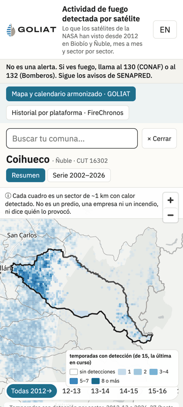
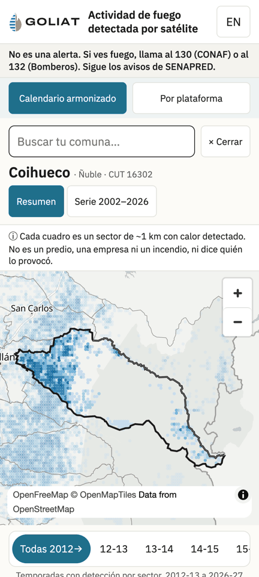
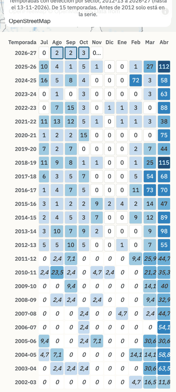
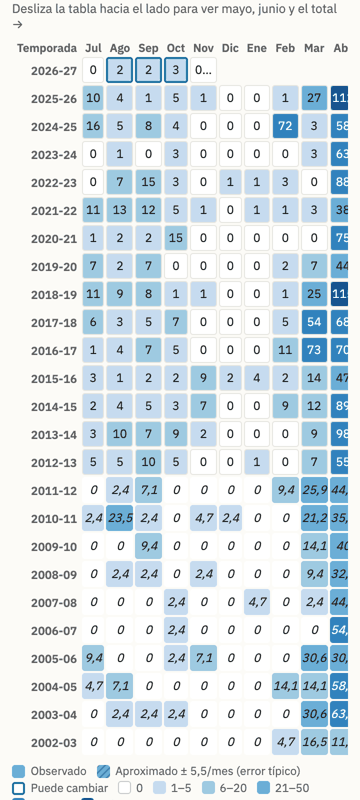

# QA móvil de punta a punta · issue #42 · 15-11-2026

La gente va a entrar a la app escaneando un QR, así que el celular pasa a ser la pantalla principal.

**Cómo se probó:** Chrome con emulación de teléfono (Playwright: pantalla táctil, DPR 2–3, `isMobile`) en 360×800 (Android medio), 375×667 (iPhone SE), 390×844 (iPhone 14) y 768×1024 (tablet). Páginas revisadas: landing ES/EN, Explorar sin comuna, comuna habilitada (Coihueco), comuna no habilitada (Concepción), serie, FireChronos e impresión. Además se hizo un recorrido táctil: buscar en la landing → abrir Explorar, deslizar con un dedo sobre el mapa, buscar otra comuna, abrir la serie, CSV de la serie y de detecciones, cambiar de idioma, PDF A4 y CSV de FireChronos. Lighthouse 12.8 en modo móvil.
**Falta:** probar en un teléfono real (Safari iOS y Chrome Android). La emulación no reproduce el zoom de iOS al tocar un campo ni el gesto de dos dedos real.

## Lo que ya estaba bien

- No hay scroll horizontal en ninguna página ni tamaño, y la consola no muestra errores.
- Landing: se lee sin zoom, el buscador aparece en la primera pantalla en 360×800 y el buscador con «chillan» encuentra Chillán y Chillán Viejo. Al tocar una opción se abre Explorar.
- CSV de la serie (`goliat_16302_Coihueco.csv`), CSV de detecciones, CSV de FireChronos, cambio de idioma y PDF A4 funcionan desde el celular. La impresión sale igual que en escritorio (ficha, serie y método).
- Datos: viajan comprimidos con gzip. `region.json` pesa 1,3 MB en disco y baja 105 KB; `comunas.geojson` baja 74 KB y la ficha de una comuna unos 14 KB.

## Problemas encontrados y corrección

| # | Problema (360 px) | Gravedad | Corrección |
|---|---|---|---|
| 1 | **El mapa de Explorar se adueñaba del scroll**: el mapa ocupa el 62 % de la pantalla y un dedo lo arrastraba en vez de bajar la página. Medido: deslizar 240 px sobre el mapa dejaba la página en `scrollY 0`. | Alta | En pantallas táctiles se activan los gestos cooperativos de MapLibre: un dedo baja la página y dos mueven el mapa, con el aviso «Usa dos dedos para mover el mapa» en ES/EN. Tocar una comuna o un cuadro sigue funcionando. Ahora: `scrollY 0 → 225`. |
| 2 | **El calendario se cortaba en abril**: mayo, junio y el total quedaban fuera, sin nada que avisara que la tabla se podía deslizar. FireChronos tenía el mismo problema. | Alta | La columna de temporadas queda fija, las celdas son algo más angostas y aparece la pista «Desliza la tabla hacia el lado para ver mayo, junio y el total →». La pista no sale en la impresión. |
| 3 | Las capas del mapa se tapaban: la leyenda quedaba encima de la barra de temporadas, y el rótulo de temporada encima del crédito de OpenStreetMap. | Media | En celular el aviso queda arriba del mapa y las temporadas y la leyenda van debajo, sin superponerse. |
| 4 | Con una comuna elegida, el resumen quedaba a más de una pantalla y media de distancia, porque el mapa y la cabecera ocupaban mucho. | Media | Con una comuna elegida, el mapa baja al 44 % de la pantalla. El selector de vistas usa etiquetas cortas en una sola fila («Calendario armonizado» / «Por plataforma») y la bajada del título se oculta bajo 560 px. Al tocar «Serie 2002–2026», la página baja hasta la tabla. |
| 5 | Zonas táctiles chicas: pestañas de 27 px, selector de vistas 29 px, temporadas 27 px, zoom 29 px, CSV/Imprimir 26 px, desplegables 17 px. En la landing, botones de 38–40 px. | Media | En celular quedan en 44 px los botones, las pestañas, el buscador y «Cerrar»; las temporadas en 40 px, el zoom en 40 px y los desplegables con más área para tocar. En la landing, los botones y la pausa del mapa quedan en 44 px. |
| 6 | Letra de 8,5–9 px en los gráficos de la ficha (años y valores de «Total por temporada», «de 14» en los meses). | Baja | Mínimo de 10 px en celular. |
| 7 | Los selectores de fecha de FireChronos usaban letra de 13 px, y con eso iOS acerca la página al tocarlos. | Baja | Los campos usan 16 px en celular. |
| 8 | Rendimiento de Explorar: MapLibre (1,1 MB, 312 KB comprimido) iba en el mismo archivo que la app, así que nada aparecía hasta que se descargaba. CLS de 0,15 porque el mapa saltaba al llegar la ficha. | Media | El mapa se carga aparte (la app quedó en 18 KB comprimidos) y la cabecera de la card reserva su alto. CLS medido: **0,15 → 0,028**. |
| 9 | Accesibilidad (Lighthouse): el botón de idioma decía «EN», pero su nombre accesible era «Language». En la landing, la celda de ejemplo «Puede cambiar» tenía contraste 4,49:1. | Baja | El nombre accesible ahora es «EN · English» / «ES · Español» y la celda usa el color de texto principal. Accesibilidad de Explorar: 100. |
| 10 | El bloque de método mostraba los decimales con punto en español («8.38», «2.353», «± 5.5»), mientras la tabla usa coma. | Baja | Solo se cambia el separador según el idioma; las cifras no se redondean y siguen saliendo tal cual del JSON. |

## Lighthouse móvil (Explorar, Coihueco)

| | Antes (producción) | Después (local) |
|---|---|---|
| Rendimiento | 64 | 68 |
| Accesibilidad | 100 | 100 |
| CLS | 0,15 | 0,028 |
| TBT | 610 ms | 610 ms |

El TBT es el tiempo que el teléfono tarda en procesar MapLibre. Se puede bajar cargando el mapa solo cuando se ve, pero no es una corrección para el día de la entrega. Landing en producción: rendimiento 92, accesibilidad 97, que pasa a 100 con la corrección del contraste.

## Antes y después (360×800)

| Antes | Después |
|---|---|
|  |  |
|  |  |

## Pendiente

- Probar en un teléfono real: Safari iOS (zoom al tocar un campo, gesto de dos dedos) y Chrome Android.
- Verificación final con `usuario-final` en móvil sobre la app desplegada, una vez que esto llegue a `main`.
- En la landing, las barras de los meses tienen 20 px de ancho (pero 117 px de alto, separadas cada 28 px) y su nombre accesible no repite el texto visible. Queda como está.
